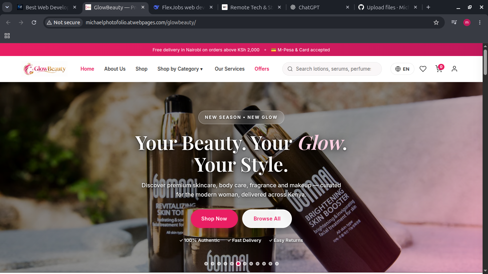
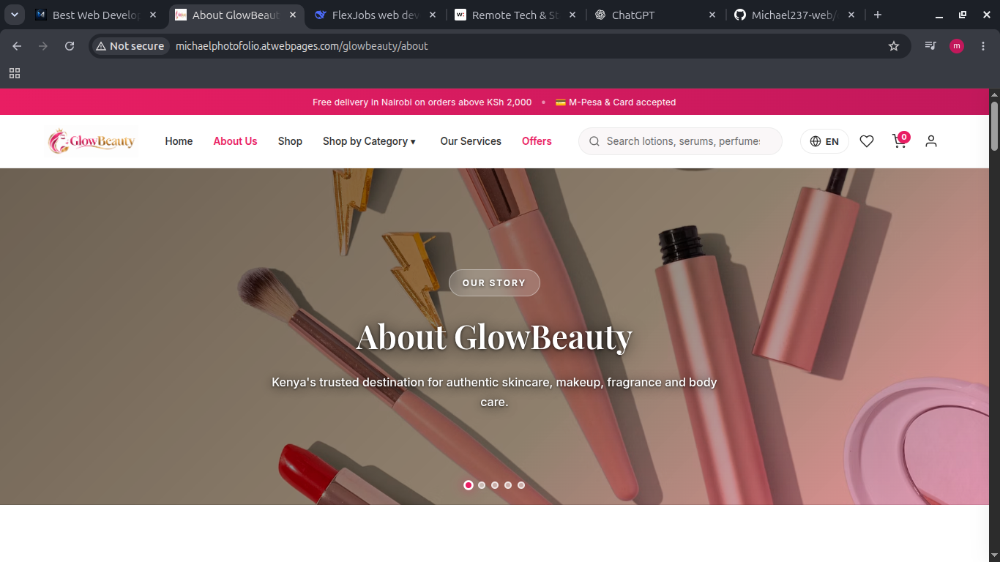
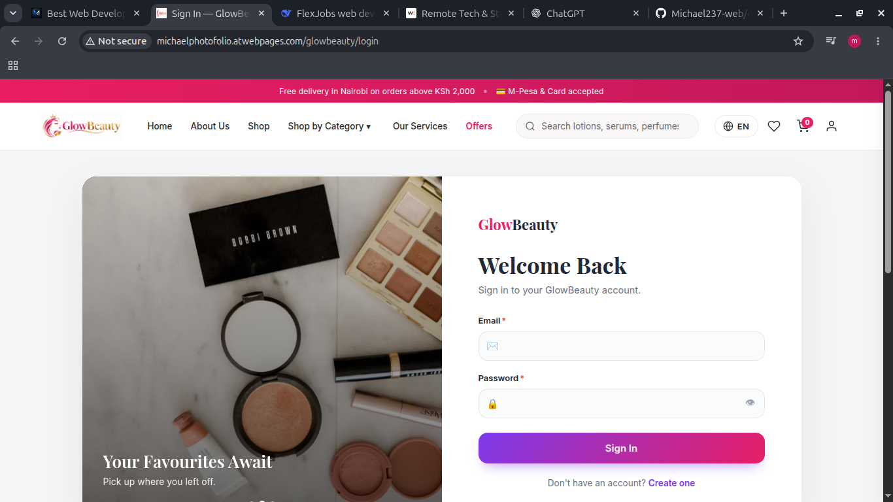
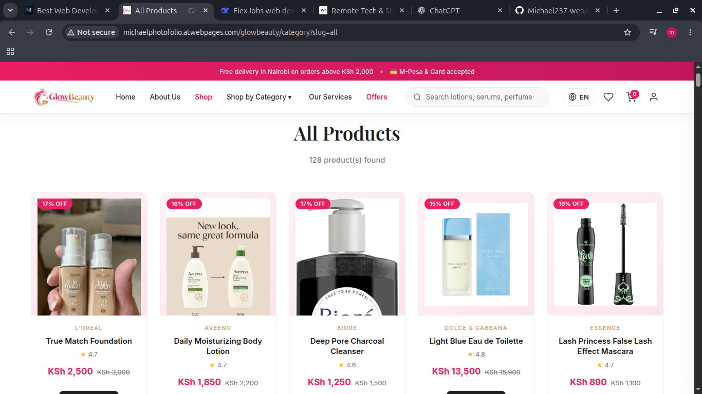
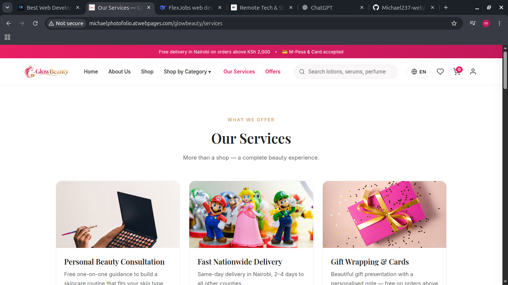

# Glow & Co. | Cosmetic E-Commerce Website


A full-stack, dynamic e-commerce website designed for a luxury cosmetic brand. This project features a complete customer-facing storefront and a secure admin dashboard for managing products, users, and orders.


**🔗 [View Live Demo](http://michaelphotofolio.atwebpages.com/glowbeauty)**

---

## 📸 Screenshots

Here is a preview of the key pages in the application:

| Home Page | About Us | Login |
| :---: | :---: | :---: |
|  |  |  |

| Products | Services |
| :---: | :---: |
|  |  |

---

## ✨ Features

**Customer Frontend:**
- **Responsive Design:** Fully optimized for mobile, tablet, and desktop screens.
- **Dynamic Product Catalog:** Products are loaded dynamically from the backend, allowing for easy updates.
- **User Authentication:** Secure login and registration system for customers.
- **Service Pages:** Dedicated pages for brand information and services.

**Admin Dashboard (Backend):**
- **Secure Admin Login:** Separate authentication for administrators.
- **Dashboard Overview:** A central hub (`admin-dashboard.php`) to manage the site.
- **Product Management:** Ability to add, edit, and delete cosmetic products.
- **User Management:** View and manage registered customers.

---

## 🛠️ Tech Stack

**Frontend:**
- HTML5
- CSS3 (Flexbox, Grid, Custom Properties)
- JavaScript (ES6+)

**Backend:**
- PHP (Server-side scripting)
- MySQL (Database for products, users, and orders)

**Tools & Deployment:**
- Git & GitHub for version control
- [XAMPP / WAMP / MAMP] for local development
- [VS Code] as the code editor

---

## 🚀 Getting Started

To get a local copy up and running, follow these simple steps.

### Prerequisites
You will need a local server environment that supports PHP and MySQL.
- [XAMPP](https://www.apachefriends.org/index.html) (Recommended for beginners)
- Or [WAMP](https://www.wampserver.com/en/) / [MAMP](https://www.mamp.info/en/)

### Installation

1. Clone the repository into your local server's root directory (e.g., `htdocs` for XAMPP):
   ```bash
   git clone https://github.com/Michael237-web/cosmetic-website.git
